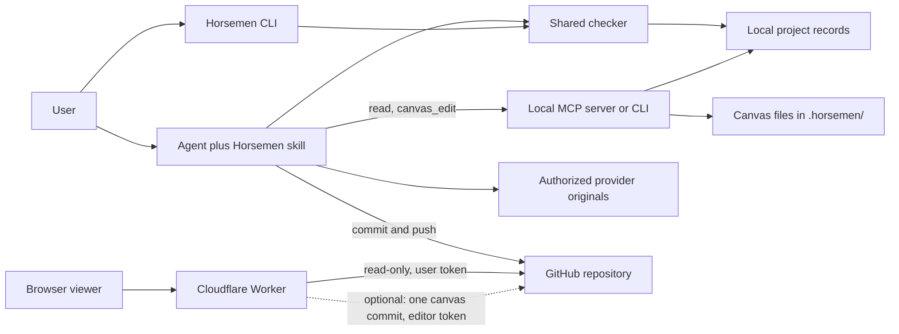
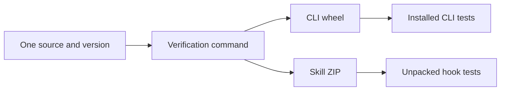

# Anatomy

One repository owns the agent skill, CLI, shared checks, and release verification.

## Map

```text
./
├── .horsemen/canvas/      Canvas files of this project, such as the roadmap board (`roadmap.canvas`)
├── web/                   GitHub canvas (local and hosted), Markdown, diagrams (vendored Mermaid in web/vendor/), images, themes, previews, and setup guide
│   ├── assets/            Bundled fonts with their notice, icons, seals, and app icon
│   ├── canvas-sections.js Rules for the generated canvas of a record: sections, card IDs, layout, card text, and links
│   ├── canvas-format.js   Browser reader of canvas files (`.horsemen/canvas/*.canvas`): the same rules, limits, and errors as the Python reader
│   ├── canvas-view.js     Rules that make one drawing from a canvas file and the generated canvas: elements, connectors, list order, and messages
│   ├── canvas-edit.js     Edit rules shared by the browser and the Worker: draft operations, the commit message, and the merge by element ID
│   ├── canvas-editor.js   Hosted edit mode (signed-in only): move, add a note, drop or paste a file or an address, connect, delete, save, and merge; canvas-editor.css styles it
│   ├── canvas-media.js    Media rules shared by the browser and the Worker: type from the bytes, the file name from the SHA-256, size and count limits
│   ├── canvas-embeds.js   Click-to-load players: a provider address to a frame address, and the frame-src list of both servers
│   ├── canvas-table.js    CSV and TSV tables: rows, limits, and escaped markup
│   ├── hosted-reader.js   Browser port of the Python GitHub reader, for hosted mode
│   └── hosted.js          Hosted mode: proxy reads, the editor sign-in and saves, sign-out, and live commit checks
├── worker/                Cloudflare Worker for horsemen.forsvn.com: GitHub App sign-in, read-only proxy, and the optional canvas write route
├── docs/state-machines.md  Local reader lifecycle and failure coverage
├── docs/product/           GUI requirements, artifact views, icon system, design audit, release boundaries, and the canvas workspace design with its file schema
├── docs/show-me/product-gui/ Interactive design, Excalidraw, and demo checks
├── docs/show-me/canvas-workspace/ Canvas workspace mock, fictional fixture, and fixture check
├── PRODUCT.md              GUI context and explicit prototype assumptions
├── assets/                 README cover and provenance notes
├── favicon.png             Project icon
├── horsemen/               Installable agent skill
│   ├── SKILL.md            Agent entry point
│   ├── CLI.md              Executable usage and limits
│   ├── REVIEW.md           Design decisions and remaining boundaries
│   ├── references/         Templates and focused workflows
│   └── scripts/            Compatibility hooks, provider helpers, tests
│       └── horsemen_core/  Shared checker, CLI, local editor, GitHub reader, canvas format (`canvas.py`), agent tools (`agent_tools.py`), and local MCP server (`mcp.py`)
├── scripts/                Build and end-to-end verification
├── tests/                  Distribution, GUI, canvas format, agent tool, and MCP server tests
│   └── fixtures/canvas/    Shared canvas cases for the Python and JavaScript readers, with a fictional project
├── pyproject.toml          CLI packaging; version comes from shared source
├── CONTRIBUTING.md         Setup, verification, and release procedure
├── .impeccable/            Impeccable design-check settings (one intended-colour exception)
└── .github/workflows/      Linux and macOS verification
```

## Read before changing

- [CONTRIBUTING.md](CONTRIBUTING.md) for tests and artifacts.
- [horsemen/SKILL.md](horsemen/SKILL.md) for the record contract.
- [horsemen/references/cli.md](horsemen/references/cli.md) for interface limits.

## Commands

- Run local GUI: `python3 scripts/serve_gui.py`; see [setup and limits](web/README.md).
- Preview a coding session: `python3 scripts/serve_gui.py --project /path/to/project`.
- Hosted viewer tests: `node --test tests/test_hosted_reader.cjs worker/test/worker.test.js`.
- Hosted browser check: `python3 scripts/test_hosted_e2e.py --output /tmp/horsemen-hosted-check`.
- Canvas editing checks: `node --test worker/test/editor.test.js worker/test/setup.test.js worker/test/protected.test.js worker/test/media.test.js tests/test_canvas_edit.cjs tests/test_canvas_media.cjs`; browser check: `python3 scripts/test_hosted_edit_e2e.py --output /tmp/horsemen-edit-check`.
- Hosted speed benchmark: `python3 scripts/bench_hosted.py --repos 80 --latency 150 --output /tmp/horsemen-bench`.
- Deploy hosted viewer: `cd worker && bunx wrangler deploy`; see [deploy and limits](worker/README.md).
- Canvas rule checks: `node tests/test_canvas_state.cjs`.
- Generated canvas rule checks: `node tests/test_canvas_sections.cjs`.
- Canvas format cases: `python3 -B -m unittest tests.test_canvas_format`; add `HORSEMEN_SCHEMA_CHECK=1` to compare with the JSON Schema (needs `uvx`). The [case contract](tests/fixtures/canvas/README.md) is for both languages.
- Agent tool tests: `python3 -B -m unittest tests.test_canvas_edit tests.test_canvas_read tests.test_mcp_server` and `python3 -B horsemen/scripts/test_canvas_cli.py`.
- Read a workspace with few tokens: `PYTHONPATH=horsemen/scripts python3 -B -m horsemen_core show`; edit a canvas: `... canvas apply NAME --ops FILE`; see the [canvas guide](horsemen/references/canvas.md).
- Run the local MCP server: `python3 -B horsemen/scripts/horsemen.py mcp` (stdio). `mcp install` changes agent settings; use it only for your own setup.
- Agent session receipts: `python3 -B scripts/agent_sessions.py --output /tmp/horsemen-agent-sessions`. It starts a real Claude Code and Codex session in a temporary fictional project, with the server set for that run only. It uses your accounts and costs tokens, so verification does not run it.
- Canvas proposal fixture check: `python3 docs/show-me/canvas-workspace/check.py --schema` (needs `uvx` for the schema step).
- Preview checks: `node tests/test_gui_previews.cjs`.
- Artifact view checks: `node tests/test_gui_views.cjs`.
- Canvas file checks in the browser code: `node tests/test_canvas_format.cjs` (the reader, with the shared cases of both languages), `node tests/test_canvas_view.cjs` (the drawing rules), `node tests/test_canvas_embeds.cjs` (players and the frame-src list), and `node tests/test_canvas_table.cjs` (tables). Table reads: `python3 -B -m unittest tests.test_gui_tables`. The browser checks use the fictional canvas files in `scripts/canvas_fixture.py`.
- Browser check: `python3 scripts/test_gui_e2e.py --output /tmp/horsemen-gui-check`.
- Verify: `.venv/bin/python -B scripts/verify.py --output /tmp/horsemen-verification`.
- Read one record: `PYTHONPATH=horsemen/scripts python3 -B -m horsemen_core brain --json`.
- Update one record: see [exact edit input and exclusive-writer contract](horsemen/CLI.md#update-exactly-one-record).
- Check records: `python3 -B horsemen/scripts/horsemen.py check .`.
- Run CLI: `PYTHONPATH=horsemen/scripts python3 -B -m horsemen_core --help`.

Installed skills and virtual environments are outputs, not authoring sources.
The prior private collection retains its history; it points here for future work.

## Brain map

No external provider is configured. [BRAIN.md](BRAIN.md) owns that boundary.

## Tech stack

### Tools

| Tool and version | Why needed | What it needs | How it helps |
| --- | --- | --- | --- |
| Python 3.10+ | Local checks and CLI | Python installation | No runtime package dependencies |
| Git (optional) | Local change context | An existing repository | Adds branch and working-file evidence |
| setuptools 77.0.3 in verification | Build the wheel | Isolated build environment | Packages the shared CLI source |
| unittest and subprocess | Regression checks | Python standard library | Tests real command results and old hooks |
| JSON Canvas 1.0 with the Horsemen profile | Canvas files in `.horsemen/canvas/` | No package; the reader is in the shared source | Other tools can open the files; one element on each line keeps Git changes small |
| Model Context Protocol, stdio transport (2025-06-18) | Give agents the `read` and `canvas_edit` tools | A host that supports MCP, such as Claude Code or Codex; no package, network, or token | Agents read a workspace and edit a canvas with few tokens |
| check-jsonschema through `uvx` (optional) | Compare the reader with the canvas JSON Schema | `uvx`; only with `HORSEMEN_SCHEMA_CHECK=1` | Shows that the schema accepts and refuses the same cases |
| GitHub Actions | Cross-platform verification | Repository workflow | Tests Linux/macOS with Python 3.10/3.14 |
| skills.sh CLI (`skills`) | Agent skill installation | Node.js and npm through `npx` | Downloads Horsemen and prompts for agent and scope |
| Cloudflare Workers, Wrangler 4.165.0 | Host the viewer at horsemen.forsvn.com | A Cloudflare account with the domain; Bun to install Wrangler | Serves the app and a read-only GitHub proxy; no database, KV, or logs. The edge cache holds public repository data briefly for public views. With the optional editor app, one write route commits canvas files with the person's own token |
| GitHub App (user authorization) | Sign-in and repository access for the hosted viewer | The app settings as Worker secrets | Each user reads only repositories they can access and chose to install it on |
| Mermaid 12.3.0 (MIT), vendored in `web/vendor/` | Diagrams and charts in records | No install; the browser loads it only when a record has a `mermaid` block | Draws flowcharts, sequence diagrams, and charts in the active theme |
| Node.js 20+ | Hosted viewer and GUI tests | Node.js installation | Runs the reader parity, Worker, and view tests |
| agent-browser | Browser checks | The `agent-browser` CLI | Drives the local and hosted apps against fake GitHub data |

The workspace is static HTML, CSS, and JavaScript with self-hosted fonts and
no build step. It runs two ways. Locally, a Python standard-library server
bound to loopback reads GitHub through the GitHub CLI (`gh`) sign-in; see
[local setup](web/README.md). Hosted, a Cloudflare Worker signs users in with
a GitHub App and passes read-only GitHub calls through, and the browser parses
the records; see [hosted viewer](worker/README.md). An optional second GitHub
App lets a person save canvas edits as commits through one write route.
Neither stores project data on a server.
Provider helpers exist in the skill but have no live account connection by default.

### Runtime connections



### Development and release



See [CONTRIBUTING.md](CONTRIBUTING.md) for reproduction and limits.

The local viewer can read the title and state of a linked Linear issue on request. It uses the Linear GraphQL API with a local `LINEAR_API_KEY`. [Linear API](https://linear.app/developers/graphql)
