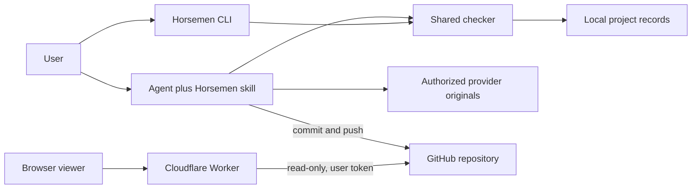
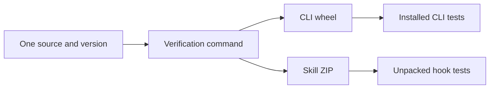

# Tech stack

## Tools

| Tool and version | Why needed | What it needs | How it helps |
| --- | --- | --- | --- |
| Python 3.10+ | Local checks and CLI | Python installation | No runtime package dependencies |
| Git (optional) | Local change context | An existing repository | Adds branch and working-file evidence |
| setuptools 77.0.3 in verification | Build the wheel | Isolated build environment | Packages the shared CLI source |
| unittest and subprocess | Regression checks | Python standard library | Tests real command results and old hooks |
| GitHub Actions | Cross-platform verification | Repository workflow | Tests Linux/macOS with Python 3.10/3.14 |
| skills.sh CLI (`skills`) | Agent skill installation | Node.js and npm through `npx` | Downloads Horsemen and prompts for agent and scope |
| Cloudflare Workers, Wrangler 4.165.0 | Host the viewer at horsemen.forsvn.com | A Cloudflare account with the domain; Bun to install Wrangler | Serves the app and a read-only GitHub proxy; no database, KV, or logs |
| GitHub App (user authorization) | Sign-in and repository access for the hosted viewer | The app settings as Worker secrets | Each user reads only repositories they can access and chose to install it on |
| Node.js 20+ | Hosted viewer and GUI tests | Node.js installation | Runs the reader parity, Worker, and view tests |
| agent-browser | Browser checks | The `agent-browser` CLI | Drives the local and hosted apps against fake GitHub data |

The workspace is static HTML, CSS, and JavaScript with self-hosted fonts and
no build step. It runs two ways. Locally, a Python standard-library server
bound to loopback reads GitHub through the GitHub CLI (`gh`) sign-in; see
[local setup](web/README.md). Hosted, a Cloudflare Worker signs users in with
a GitHub App and passes read-only GitHub calls through, and the browser parses
the records; see [hosted viewer](worker/README.md). Neither stores project
data on a server.
Provider helpers exist in the skill but have no live account connection by default.

## Runtime connections

## Development and release

See [CONTRIBUTING.md](CONTRIBUTING.md) for reproduction and limits.
